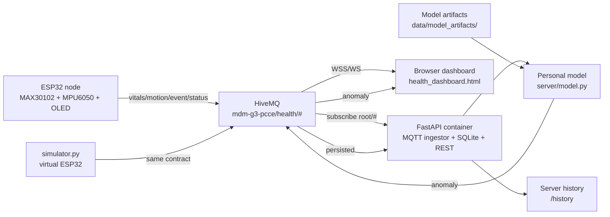

# MDM G3 Health Monitoring - Documentation

Multimodal ESP32 health-monitoring demo: body sensors -> MQTT -> FastAPI + SQLite + live dashboard, with personalized ML anomaly scoring.

Last updated: 2026-10-22

## What this project is

A working end-to-end IoT prototype for the project "Multimodal Edge-AI Based IoT System for Personalized Patient Health Monitoring and Early Anomaly Detection".

- **Sensing**: ESP32 reads a pulse oximeter (MAX30102) and a 6-axis IMU (MPU6050), shows status on an SSD1306 OLED, and drives a buzzer/LEDs.
- **Transport**: JSON messages over MQTT (HiveMQ public broker in the demo).
- **Backend**: one container runs FastAPI, the MQTT ingestor, SQLite, the REST API, and the static pages.
- **Live UI**: `health_dashboard.html` connects directly to the broker over WebSocket and tracks patients by MQTT channel.
- **History UI**: `/history` reads persisted data from the server through the REST API.
- **ML**: a calibration-normalized logistic regression scores 30-second feature windows. Training happens in Colab/Kaggle; the server runs lightweight inference.
- **Simulator**: a Python ESP32 impersonator with normal, stress, fall, no-finger, and offline scenarios.

## Status at a glance

| Area | State |
|---|---|
| ESP32 firmware (HR, SpO2, motion, fall, alerts) | Working |
| Real temperature (LM35) | Implemented in firmware (compile-tested, not yet run on the board); dashboard simulates 37-39 C until `temp` arrives |
| MQTT ingestion + SQLite + REST API | Working |
| Live dashboard + server history page | Working |
| Rule-based anomaly detection | Working |
| Personalized ML model (server) | Working, enabled by default |
| On-device ML (TFLite Micro) | Exported model only; **not integrated into firmware** |
| Colab/Kaggle training notebook | Working; LOSO artifacts committed |
| Docker image + Render blueprint | Present; see `operations.md` |
| Automated unit tests | 5 tests, passing |
| Auth / security | Intentionally absent (demo scope) |

## Architecture



Detailed data flow, message contract, and API reference: [architecture.md](architecture.md).

## Documentation index

| Document | Contents |
|---|---|
| [architecture.md](architecture.md) | Components, MQTT contract, ingestion pipeline, anomaly logic, database schema, REST API |
| [edge-ai.md](edge-ai.md) | Dataset, features, personalization, model results, artifacts, ESP32/TFLite plan, limitations |
| [hardware.md](hardware.md) | Sensors, wiring/pins, firmware configuration, build/flash, LM35 plan |
| [operations.md](operations.md) | Local run, simulator, Docker, Render, HiveMQ, tests, troubleshooting |
| [experiments.md](experiments.md) | Research protocol, LOSO results, threats to validity, remaining experiments |
| [roadmap.md](roadmap.md) | Completed work, open tasks, acceptance criteria |

## Quick start

```bash
python3 -m venv .venv
.venv/bin/pip install -r requirements.txt
.venv/bin/uvicorn server.main:app --host 127.0.0.1 --port 8000
```

Open:

- Dashboard: <http://127.0.0.1:8000/>
- Server history: <http://127.0.0.1:8000/history>
- API docs: <http://127.0.0.1:8000/docs>

Publish a virtual patient:

```bash
.venv/bin/python simulator.py --device sim01 --scenario normal --duration 60
.venv/bin/python simulator.py --device sim02 --scenario stress --duration 60
.venv/bin/python simulator.py --device sim03 --scenario fall --duration 60
```

In the dashboard, add a patient with channel `mdm-g3-pcce/health/sim01` (or `sim02`, `sim03`). The ML score becomes available after the calibration period (120 seconds by default, then the model scores every 15 seconds).

## Repository layout

```text
.
|-- health_node.ino              ESP32 firmware
|-- health_dashboard.html        live dashboard (single file)
|-- simulator.py                 virtual ESP32 / scenario generator
|-- server/
|   |-- main.py                  FastAPI app + REST API
|   |-- mqtt_ingest.py           MQTT subscription and routing
|   |-- model.py                 features, personal model, device buffers
|   |-- anomaly.py               rule-based vitals checks
|   |-- db.py                    SQLite schema and queries
|   |-- config.py                environment configuration
|   `-- static/history.html      server-side history page
|-- notebooks/
|   `-- noneeg_training.ipynb    Colab/Kaggle training and evaluation
|-- data/
|   `-- model_artifacts/         trained models, metrics, predictions
|-- tests/test_model.py          unit tests for features/model
|-- docs/                        this documentation
|-- Dockerfile
|-- render.yaml
`-- requirements.txt
```

## Demo caveats

- The public HiveMQ broker is for test data only. Do not publish real patient data to it.
- There is no authentication or authorization on the API or MQTT topics.
- The Render free plan uses an ephemeral filesystem; the SQLite database is lost on restart or redeploy.
- The current firmware does not publish temperature. The dashboard keeps a simulated 37-39 C value until `temp` arrives.
- Firmware WiFi credentials are kept directly in the sketch by project decision; do not reuse that pattern for production.
